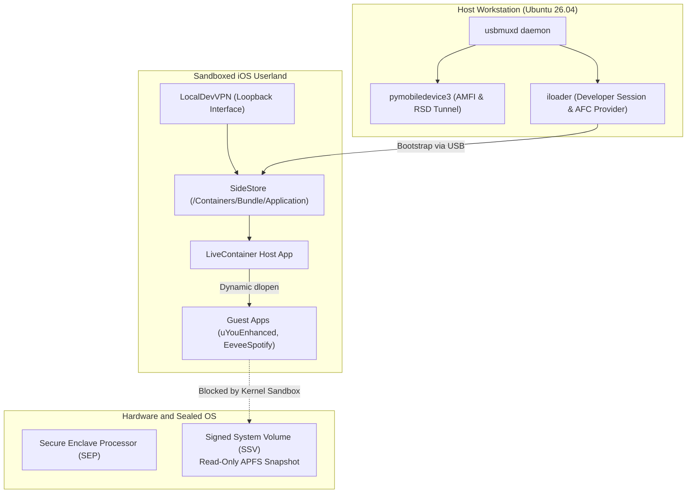

<p align="center">
  
</p>

<h1 align="center">iOS Sideloading Toolkit</h1>

<p align="center">
  A reproducible, zero-risk Linux-to-iOS 17/18 sideloading pipeline, DIY IPA build toolchain, and local IPA vault.
</p>

<p align="center">
  <a href="#"></a>
  <a href="#"></a>
  <a href="#"></a>
  <a href="LICENSE"></a>
</p>

<p align="center">
  <a href="#overview">Overview</a> &bull;
  <a href="#architecture">Architecture</a> &bull;
  <a href="#project-structure">Structure</a> &bull;
  <a href="#installation">Installation</a> &bull;
  <a href="#usage">Usage</a> &bull;
  <a href="#livecontainer--3-app-limit-bypass">3-App Bypass</a> &bull;
  <a href="#diy-ipa-building">DIY Building</a> &bull;
  <a href="#curated-app-vault">App Vault</a> &bull;
  <a href="#security">Security</a> &bull;
  <a href="#license">License</a>
</p>

## Overview

Modern iOS versions (iOS 17 and iOS 18) replaced legacy lockdown debugging with RemoteXPC and Remote Service Discovery (RSD) over encrypted userspace tunnels. Traditional Linux sideloading utilities frequently fail under this protocol shift.

This repository provides a complete, tested toolchain for Ubuntu Linux to bootstrap, pair, and provision unsigned and modified applications onto iPhone 15 devices. Once bootstrapped via USB using `iloader`, the system operates in an autonomous, untethered loopback configuration via `SideStore` and `LocalDevVPN`, allowing on-device 7-day certificate refreshes over Wi-Fi without needing a computer.

## Architecture



### Provisioning Channel Comparison

| Operational Metric | Desktop Bootstrap (`iloader`) | On-Device Sideloading (`SideStore`) |
| :--- | :--- | :--- |
| **Execution Medium** | Ubuntu Linux CLI / Desktop GUI | iPhone 15 Native UI |
| **Transport** | USB-C (`usbmuxd` lockdown socket) | Local VPN Loopback (`LocalDevVPN`) |
| **Lifecycle Refresh** | Requires connecting to PC every 7 days | Autonomous wireless refresh over Wi-Fi |
| **Active Slot Footprint** | Consumes 1 of 3 Apple ID slots | Consumes 1 of 3 Apple ID slots |
| **Sandbox Isolation** | Standard iOS Userland Container | Standard iOS Userland Container |

## Project Structure

```
.
├── LICENSE                      # MIT Open Source License
├── README.md                    # Core technical documentation
├── SECURITY.md                  # Security boundary and threat model analysis
├── assets/
│   └── logo.png                 # Compressed repository header logo
├── bin/
│   └── iloader                  # Desktop companion launcher script
├── config/
│   ├── SideStore.conf           # WireGuard loopback configuration profile
│   ├── SideStore_WireGuard_QR.png # Scan QR code for 1-tap tunnel configuration
│   └── SideStore.pairingFile    # Local pairing record (git-ignored)
├── docs/                        # In-depth technical specifications
│   ├── IPA_VAULT.md             # Vault organization and community catalog guide
│   ├── LIVECONTAINER_GUIDE.md   # JIT-less configuration and 3-app limit resolution
│   └── TROUBLESHOOTING.md       # Diagnostic matrix and error recovery steps
├── ipas/                        # Local IPA vault directory (binaries git-ignored)
│   └── .gitkeep
├── profiles/
│   └── sources.json             # Curated SideStore community sources feed
└── scripts/
    ├── build_uyou.sh            # uYouEnhanced DIY building workflow dispatcher
    ├── fetch_ipas.sh            # Automated downloader for verified open-source IPAs
    ├── patch_ipa.sh             # Local CLI tweak injector powered by Cyan
    └── setup_linux.sh           # Environment diagnostics and prerequisite checker
```

## Installation

### Prerequisites

Ensure base USB and Python utilities are present on your Linux host:

```bash
sudo apt update
sudo apt install -y usbmuxd libimobiledevice-utils python3 python3-pip curl qrencode
```

Install `pymobiledevice3` for low-level iOS 17+ tunnel management:

```bash
pip3 install --user --break-system-packages pymobiledevice3
```

Verify your device is attached and recognized:

```bash
pymobiledevice3 usbmux list
```

### Revealing Developer Mode on iOS

Apple conceals the Developer Mode toggle by default. Send the AMFI reveal packet over USB:

```bash
pymobiledevice3 amfi reveal-developer-mode
```

On your iPhone, navigate to **Settings > Privacy & Security > Developer Mode**, toggle it **ON**, and reboot the device.

## Usage

### 1. Bootstrapping SideStore via iloader

Launch the desktop helper:

```bash
./bin/iloader
```

1. Select your target connected device.
2. Sign in with your Apple ID and complete the Two-Factor Authentication (2FA) prompt.
3. Click **Install SideStore**.
4. On your iPhone, navigate to **Settings > General > VPN & Device Management** and tap **Trust [Your Apple ID]**.

### 2. On-Device Wireless Loopback Configuration

1. Install **LocalDevVPN** from the Apple App Store.
2. Open LocalDevVPN, allow the configuration profile, and toggle it **ON**.
3. Open **SideStore**, navigate to **Settings**, and sign in with the same Apple ID.
4. Your iPhone can now install and refresh applications wirelessly without PC intervention.

## LiveContainer & 3-App Limit Bypass

Free Apple Developer profiles restrict devices to **3 active installed application bundles**. Installing standalone IPAs for SideStore, LiveContainer, and Lightroom exhausts all available App ID slots, causing subsequent installations to fail with `ApplicationVerificationFailed`.

To run unlimited additional applications (such as YouTube and Spotify) without consuming extra slots:

1. **Keep SideJITServer Disabled:** In **SideStore > Settings**, verify that **Enable SideJITServer** is set to **OFF**. JIT-less mode does not require an active debugger server.
2. **Export Certificate from Keychain:** In **SideStore > Settings**, tap your developer account row. Long-press the certificate entry, select **Export Certificate**, enter password `password`, and save it to the Files app.
3. **Import into LiveContainer:** In **LiveContainer > Settings**, tap **Import Certificate**, select the exported `.p12` file, and supply password `password`. Select the provisioning profile and verify success via **JIT-Less Mode Diagnose**.
4. **Load Guest Apps:** In LiveContainer's **Apps** tab, tap `+` to add and launch unlimited IPAs.

Detailed architectural specifications and recovery steps are documented in [docs/LIVECONTAINER_GUIDE.md](docs/LIVECONTAINER_GUIDE.md) and [docs/TROUBLESHOOTING.md](docs/TROUBLESHOOTING.md).

## DIY IPA Building

Certain developers distribute modifications as source code or tweaks due to legal or licensing constraints. This toolkit provides automated scripts to build and inject tweaks on Linux.

### Building uYouEnhanced (YouTube Ad-Free)

Run the automated building helper:

```bash
./scripts/build_uyou.sh
```

The script supports two workflows:
- **Cloud Dispatch (Recommended):** Leverages GitHub Actions to compile `uYouEnhanced` against clean YouTube binaries directly in CI, producing a downloadable artifact.
- **Local Patching:** Utilizes `cyan` to merge `uYou.deb` and `uYouEnhanced.dylib` into a decrypted YouTube IPA.

### Injecting Custom Tweaks into Any IPA

Use the universal tweak injector script:

```bash
./scripts/patch_ipa.sh -i base_app.ipa -f tweak.deb -o patched_app.ipa
```

## Curated App Vault

The `ipas/` directory serves as your local staging vault. Large binaries (> 100 MB) are excluded from git tracking to adhere to repository limits.

Download verified releases into your vault using the helper:

```bash
./scripts/fetch_ipas.sh
```

### Recommended Application Profiles

| Application | Category | Highlights | Upstream Repository |
| :--- | :--- | :--- | :--- |
| **LiveContainer** | Utility | Bypasses the 3-app sideload limit by hosting guest apps dynamically. | [LiveContainer](https://github.com/LiveContainer/LiveContainer) |
| **UTM SE** | Virtualization | QEMU-based virtual machine runner for Linux and Windows on iOS. | [UTM SE](https://github.com/utmapp/UTM) |
| **uYouEnhanced** | Media | YouTube without ads, SponsorBlock, background playback, and downloads. | [uYouEnhanced](https://github.com/arichornlover/uYouEnhanced) |
| **EeveeSpotify** | Media | Spotify with unlimited skips, zero audio ads, and synchronized lyrics. | [EeveeSpotify](https://github.com/whoeevee/EeveeSpotify) |
| **Delta** | Emulation | Multi-system console emulator for Nintendo DS, GBA, SNES, and N64. | [Delta](https://github.com/rileytestut/Delta) |
| **PPSSPP** | Emulation | Sony PSP emulator with 60 FPS patches and high-resolution scaling. | [PPSSPP](https://github.com/hrydgard/ppsspp) |

For comprehensive catalogue sources and feeds, consult [docs/IPA_VAULT.md](docs/IPA_VAULT.md).

## Security

- **Sandbox Confinement:** All provisioned applications execute inside sandboxed containers (`/private/var/mobile/Containers`).
- **Complete Deletion:** Deleting an application cleanses the executable and purges its data container with zero leftover cache.
- **Credential Protection:** Device pairing files, developer certificates, and private keys are barred from git commits via `.gitignore`.
- Refer to [SECURITY.md](SECURITY.md) for full vulnerability reporting and threat model details.

## License

This project is licensed under the [MIT License](LICENSE).
