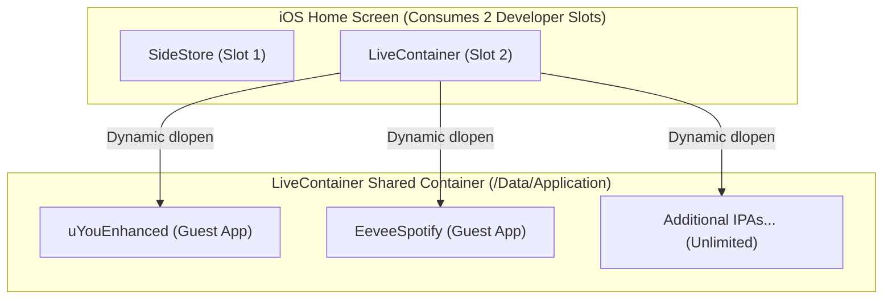

# LiveContainer JIT-less Configuration Guide

This guide details how to bypass the 3-app personal Apple Developer sideloading limit on iOS 17 and iOS 18 using LiveContainer in JIT-less mode.

## Background: The 3-App Limitation

Apple strictly restricts free (non-paid) Apple Developer accounts to **3 active installed application bundles** per device. When attempting to install a 4th standalone bundle using SideStore or any sideloading utility, the iOS kernel returns:

```text
ApplicationVerificationFailed: This device has reached the maximum number of installed apps using a free developer profile:
- com.SideStore.SideStore
- com.kdt.livecontainer
- com.adobe.lrmobilephone
```

Each standalone app consumes 1 full provisioning slot.

## Architecture: How LiveContainer Bypasses the Limit

LiveContainer acts as an execution container rather than a separate app installation:



Rather than registering new application bundles with `installd`, LiveContainer loads guest IPAs into memory as dynamic libraries (`dlopen`) inside its own sandboxed process. Consequently, you can install dozens of guest applications while consuming only **1** developer slot.

## JIT vs. JIT-less Mode on iOS 17/18

On iOS 17 and 18, Apple removed local Just-In-Time (JIT) compilation interfaces. Enabling JIT normally requires tethering to a PC or using a remote debugger.

LiveContainer provides **JIT-less Mode**, which re-signs dynamic libraries and prepares guest apps to execute without requiring JIT compilation or an active SideJITServer.

## Step-by-Step JIT-less Setup

### 1. Disable SideJITServer

In **SideStore > Settings**:
- Ensure **Enable SideJITServer** is toggled **OFF**.
- SideJITServer is unnecessary for JIT-less guest execution. The "Unreachable" status displayed when it is toggled on can be disregarded.

### 2. Export Signing Certificate from SideStore

SideStore generates a personal developer signing certificate upon authentication. To prevent exposure, SideStore stores the `.p12` private key in the secure **iOS Keychain**, not on the filesystem.

To export it:
1. Open **SideStore**.
2. Tap the **Settings** tab.
3. Tap your **Apple ID email** (or developer account row).
4. **Long-press (press and hold)** on the active certificate entry.
5. Tap **Export Certificate** (or **Export .p12**).
6. Set an export password: `password` (lowercase).
7. Select **Save to Files** and save the file to `On My iPhone > Downloads` or `LiveContainer`.

### 3. Import Certificate into LiveContainer

1. Open the **LiveContainer** app.
2. Tap the **Settings** icon.
3. Tap **Import Certificate** (choose from Files).
4. Browse and select the `ALTCertificate.p12` file saved in step 2.
5. Enter the export password: `password`.
6. When prompted for the provisioning profile, select the `.mobileprovision` file located in the same directory.
7. Tap **JIT-Less Mode Diagnose** and tap **Test**.
8. Verify that the diagnostic displays **Success**.

### 4. Installing Guest Applications

1. In LiveContainer, select the **Apps** tab.
2. Tap the **`+`** icon in the upper-right corner.
3. Select an IPA from your device storage (e.g., `uYouEnhanced.ipa` or `EeveeSpotify.ipa`).
4. LiveContainer automatically re-signs and stages the executable.
5. Tap the app icon inside LiveContainer to launch.

## Upgrading and Managing Guest Apps

- **Updating Apps:** To update a guest app, tap `+` in LiveContainer and select the newer IPA. Choose **Overwrite** when prompted.
- **Deleting Apps:** Swipe left on any guest app inside LiveContainer and tap **Delete**. All cached guest application data is purged immediately.
